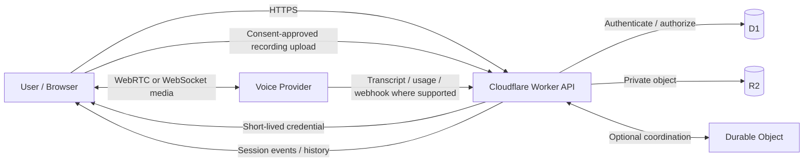

# System Architecture

**Status:** Proposed; provider and deployment decisions remain open  
**Last reviewed:** 2026-10-31

## 1. Architecture principles

1. Keep the browser-to-provider audio path as direct as practical to avoid unnecessary media proxy latency and bandwidth.
2. Keep account identity, authorization, provider master secrets, policy enforcement and persistence under the VTR-CASA backend's control.
3. Place providers behind a normalized adapter boundary.
4. Persist metadata and user-approved artefacts, not raw audio by default.
5. Make consent, recording state and retention explicit, observable session attributes.
6. Treat the PoC as a browser experience, not as an approximation of cellular call integration.

## 2. Logical components

- **React + TypeScript web client:** session controls, microphone access, playback, state display, consent, transcript and summary UI.
- **Cloudflare Worker API:** authenticates the account holder, authorizes session creation, issues short-lived provider credentials, applies rate and duration limits, records session metadata, receives webhooks where applicable and exposes history/deletion APIs.
- **Provider adapter:** translates normalized VTR-CASA commands/events into a provider's real-time protocol. The initial implementation may be server-light if provider browser connectivity is supported.
- **Voice provider:** owns the real-time inference path: speech input, turn detection, model reasoning and synthesized speech.
- **Durable Object (optional):** coordinates one active application session, enforces lifecycle transitions, tracks connection state and handles callbacks where coordination is needed. It is not required merely because audio is real-time.
- **D1:** stores account references, session metadata, consent events, normalized transcript/summary references, usage measurements and deletion status.
- **R2:** stores opt-in audio recordings and exported artefacts as private objects, accessed only through authenticated application operations.
- **Observability:** structured event timings, provider usage, error codes and privacy-safe operational metrics.

## 3. Proposed high-level topology

The diagram represents logical responsibilities, not a committed protocol. Provider capabilities differ. Some providers may deliver transcript and usage events only on the live connection; if so, the browser adapter must forward only required normalized metadata to the backend.

## 4. Real-time audio connection options

### Option A — Browser direct with short-lived credential

1. Browser calls the VTR-CASA Worker after user authentication and a deliberate start action.
2. Worker checks entitlement, session limits, provider configuration and any required consent state.
3. Worker requests an ephemeral credential or signed URL from the selected provider using a server-held secret.
4. Worker returns only the short-lived credential and permitted session configuration.
5. Browser connects to provider using WebRTC or WebSocket and streams audio directly.
6. Browser receives agent audio and provider events. It forwards only required normalized metadata to VTR-CASA.
7. Browser ends provider session and notifies Worker.

This is a good fit for low-latency PoC work. The provider's credential scope and TTL must be checked carefully: a short-lived credential reduces exposure but does not replace application authorization, quotas or abuse controls.

### Option B — Backend-mediated session negotiation

The browser sends an SDP offer to the Worker. The Worker authenticates to the voice provider, negotiates the session and returns the answer. Media may still flow directly between the browser and provider after negotiation, depending on the provider protocol. This keeps more setup control server-side but puts the backend on the connection-establishment path.

### Option C — Backend media relay

The browser streams audio to a Worker/other media service, which relays it to the provider. This offers stronger centralized inspection and routing but adds latency, bandwidth, buffering and operational complexity. Do not choose this by default. Confirm whether the runtime can support the required bidirectional stream and session duration before considering it.

## 5. Normalized provider boundary

Suggested application-level interfaces (illustrative, not implementation code):

- `VoiceProvider.createSession(config)` — returns session ID, connection method and short-lived client credential.
- `VoiceProvider.normalizeEvent(raw)` — maps provider events into domain events.
- `VoiceProvider.endSession(id)` — ends a live session when supported.
- `VoiceProvider.getUsage(id)` — returns usage measurements where available.
- `VoiceProvider.getTranscript(id)` — returns transcript when provider-hosted retrieval exists.
- `VoiceProvider.capabilities()` — declares supported transport, barge-in, transcript, usage, recording and language features.

Normalized events may include: session.started, user.speech_started, user.turn_completed, agent.thinking, agent.audio_started, agent.audio_completed, conversation.transcript_delta, conversation.transcript_final, tool.requested, session.interrupted, usage.reported, provider.error and session.ended.

Never assume every provider supports every event. Missing capabilities should be represented explicitly rather than emulated silently.

## 6. Session and data model

Minimum entities:

- **Account:** internal opaque identifier and authentication provider reference.
- **Session:** ID, owner ID, provider, model/configuration version, start/end times, status, locale, consent state and retention deadline.
- **ConsentEvent:** session ID, purpose (microphone, recording, transcript/summary), choice, notice version, timestamp and actor. Avoid storing unnecessary identity data about other participants.
- **TranscriptTurn:** session ID, sequence, speaker role, text, time offsets, source and confidence/quality metadata where supplied.
- **Summary:** session ID, generated content, generation model/version, created time and user-edited state.
- **RecordingObject:** session ID, private R2 key, media type, duration, size, checksum, retention deadline and deletion status.
- **UsageEvent:** session ID, provider, model, category, quantity, unit, price version, estimated amount and provider-reported amount when available.
- **LatencyMetric:** session ID, turn index, metric name, measured duration and measurement source.

Use opaque IDs in URLs and logs. Enforce ownership in every read, write and delete operation.

## 7. Recording flow

Prefer local/browser recording or provider-side recording only after the user opts in and the required notice/consent flow is satisfied. For browser-side capture, use the same microphone stream already granted for the session where technically possible. Recording must have an independent state indicator and immediate stop control.

When enabled, upload in bounded chunks or after the session according to the tested browser implementation. Use authenticated upload authorization, size and duration limits, content-type validation, per-account quotas and private R2 storage. Do not expose a public R2 bucket or permanent object URL. Avoid buffering entire recordings in Worker memory.

## 8. Transcript and summary flow

Provider live transcription may be used where available, but persist it only according to user settings and provider terms. Alternatively, transcribe a consented recording after the session. Store provenance for every transcript: live provider, post-session transcription or user correction.

Generate summaries asynchronously after the session ends. Summaries should be AI-labelled and should distinguish caller claims from verified facts, and flag ambiguity. Keep the original transcript separate from a user-edited summary.

## 9. Cloudflare fit and constraints

- **Workers:** suitable for authentication, ephemeral credential issuance, policy, webhooks, rate limiting, validation and metadata operations. Do not assume Workers should carry all live media.
- **Durable Objects:** useful for per-session coordination and WebSocket server use cases. Hibernation applies to accepted inbound WebSockets on the Durable Object server side; it is not a generic solution for an outbound provider connection or a WebRTC media relay.
- **D1:** suitable for relational session metadata, consent events and structured transcripts, subject to size/query limits and indexing design. Large audio belongs in object storage.
- **R2:** suitable for private recording objects and exports. Keep bucket access behind authorization and apply retention/deletion processes.
- **Workers Static Assets or Pages:** may host the React client; hosting choice is not important to the voice-provider boundary.
- **Queues (optional):** can decouple post-call transcription, summary creation and deletion retries. Not required until asynchronous workload needs justify it.

Cloudflare's CPU, memory, request, database and storage constraints change by plan. Re-check current plan limits before designing a media path or estimating recurring cost.

## 10. Security boundaries

- Browser receives no provider master key, database credential or permanent storage credential.
- Short-lived tokens are issued only after application authentication and authorization.
- CORS is not an authentication mechanism.
- Enforce server-side session limits, token issuance limits, duration ceilings and account quotas.
- Require TLS; use secure cookies or an equivalent sound browser auth mechanism.
- Validate webhook authenticity, replay protection and event ownership.
- Use least privilege for R2 objects, signed downloads and deletion.
- Redact secrets, raw transcripts and caller phone numbers from general logs.
- Protect against prompt injection and social engineering: voice content is untrusted input.
- Store model/prompt versions for incident analysis.
- Add an emergency kill switch to revoke session creation and disable a provider.

## 11. Deployment and environment boundaries

Development, preview and production should use separate provider credentials, databases and storage buckets. Preview environments should have synthetic users and non-sensitive test conversations. Secrets belong in Cloudflare secrets, never in Git. Use GitHub Actions for validation and deployment only after implementation decisions are reviewed.

## 12. Architecture risks

| Risk | Mitigation |
|---|---|
| Browser network and permission variance | Test supported browsers/devices and graceful fallback |
| Provider direct-connect protocol changes | Adapter boundary and contract tests |
| Short-lived token leakage | Short TTL, scoped token, no local storage, redact logs |
| Recording consent ambiguity | Default off, explicit control, clear notice, jurisdiction review |
| Incomplete or delayed provider usage events | Compare provider usage with independent duration/timing metrics |
| Durable Object overuse | Use only where coordination/state justifies it |
| Storage cost and retention drift | Explicit retention deadline, lifecycle policy, deletion reconciliation |
| Provider lock-in | Normalized domain events and provider capability matrix |
| Telephone/iOS constraints | Separate research phase; do not assume public APIs expose cellular audio |

## 13. Open architecture questions

- Which provider transport performs best in the target browsers and regions?
- Is a React SDK useful, or should the first integration use the lower-level WebRTC/WebSocket interface?
- Which provider provides the most dependable transcript/usage event stream?
- Should recording happen browser-side or via provider recording?
- What is the simplest secure account authentication for a single-user PoC?
- Do we need a Durable Object in Phase 1, or will stateless Workers endpoints be enough?
